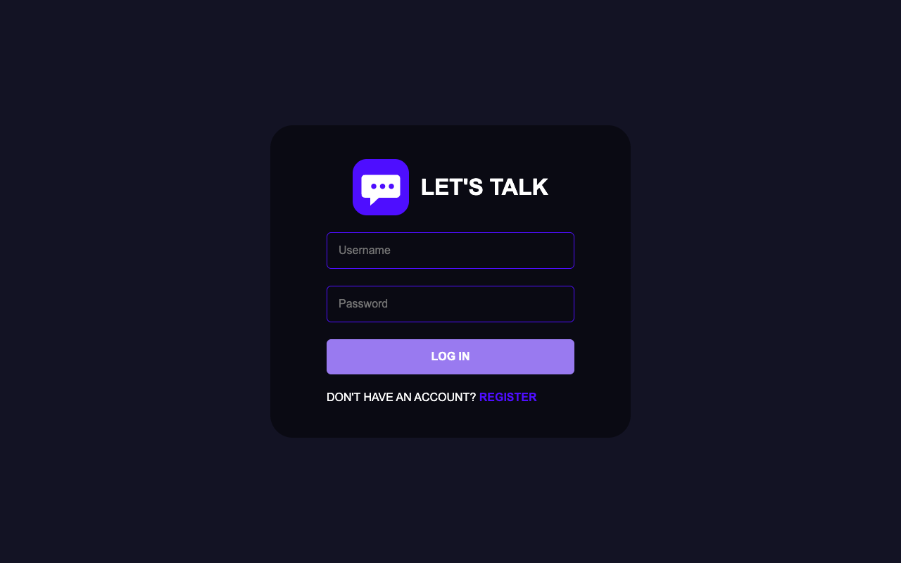
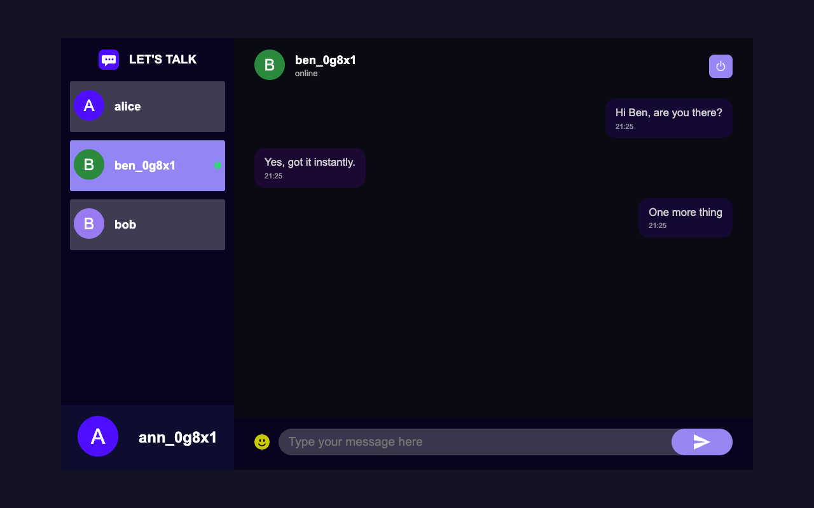

# Let's Talk: real-time chat app

A small full-stack chat application. Users register, pick an avatar, see the other users and exchange one-to-one messages that arrive instantly through WebSockets.

The repository started as an unfinished Create React App front end with no backend. The front end was repaired and a TypeScript server was added.

## Stack

- Client: React 18 (Create React App), styled-components, react-router, react-toastify, emoji-picker-react, socket.io-client, axios
- Server: Node 20, TypeScript (strict), Express 5, Mongoose 8, Socket.IO 4, zod validation, bcryptjs, jsonwebtoken, helmet, cors, express-rate-limit
- Tests: Jest + ts-jest + supertest + socket.io-client (server), Jest + React Testing Library (client), Postman collection run with newman
- Tooling: Docker, docker-compose, GitHub Actions

## Screenshots

| Login | Conversation (sender's view) |
| --- | --- |
|  |  |

The recipient's view of the same conversation is in `docs/chat-recipient.png`. Screenshots were taken from the running app with Playwright and two separate browser contexts.

## Architecture

```
client/  React SPA  --REST (axios, Bearer JWT)-->  server/  Express routes --> Mongoose --> MongoDB
                    --WebSocket (Socket.IO, JWT in handshake)-->  ChatHub (online map, rooms)
```

- Passwords are hashed with bcrypt. Login and registration return a JWT (7 days by default). The client stores it in `localStorage` and sends it as `Authorization: Bearer <token>`.
- The sender of a message always comes from the token, never from the request body.
- Sockets are authenticated in a Socket.IO middleware. Each user joins a room named after their id, so every tab of a user receives their messages. The hub keeps an online users map.
- A message is saved first and pushed to the recipient afterwards. Messages sent through REST are pushed live too.

## API

All errors have the shape `{ "status": false, "msg": "..." }`. Routes marked "auth" need a Bearer token.

| Method | Path | Auth | Body | Success response |
| --- | --- | --- | --- | --- |
| GET | `/api/health` | no | | `{ status: true, uptime }` |
| POST | `/api/auth/register` | no (rate limited) | `username, email, password` | 201 `{ status, user, token }` |
| POST | `/api/auth/login` | no (rate limited) | `username, password` | `{ status, user, token }` |
| GET | `/api/auth/me` | yes | | `{ status, user }` |
| POST | `/api/auth/setAvatar` | yes | `image` (base64 SVG) | `{ status, isSet, image }` |
| GET | `/api/auth/allusers` | yes | | array of users, excluding the caller |
| POST | `/api/messages/add` | yes | `to, message` | 201 `{ status, message }` |
| GET | `/api/messages/:userId` | yes | | `{ status, messages }` for the conversation with that user |

Status codes used: 400 validation, 401 missing/invalid token or bad credentials, 404 unknown recipient or route, 409 duplicate username or email, 429 rate limit.

## Socket events

The client connects with `io(url, { auth: { token } })`. A missing or invalid token is rejected with `Authentication required`.

| Event | Direction | Payload |
| --- | --- | --- |
| `msg-send` | client to server | `{ to, message }` with an acknowledgement callback receiving `{ status, message }` or `{ status: false, msg }` |
| `msg-receive` | server to recipient | the saved message `{ id, from, to, text, createdAt }` |
| `msg-sent` | server to sender's sockets | the saved message (lets other tabs of the sender stay in sync) |
| `online-users` | server to all | array of user ids that are currently connected |

## Setup

Requirements: Node 20. No MongoDB install is needed for development.

```
# terminal 1: API on port 5200 with an in-memory MongoDB and two demo users
cd server
npm install
npm run dev:memory        # alice / bob, password: demo-password-1

# terminal 2: React app on port 5210
cd client
npm install
PORT=5210 npm start
```

`dev:memory` downloads a MongoDB binary through `mongodb-memory-server` the first time it runs and loses all data when stopped. Set `CLIENT_ORIGIN` if the client runs on another origin than `http://localhost:5210`.

To use a real MongoDB, copy `server/.env.example` to `server/.env`, adjust it and run `npm run dev` (or `npm run build && npm start`).

Client options (see `client/.env.example`): `REACT_APP_API_URL` for the server address and the optional `REACT_APP_AVATAR_API`.

### Avatars

Avatars are generated locally in the browser (coloured initials as SVG), so the app works offline. If `REACT_APP_AVATAR_API` is set the client tries that service first. When it cannot be reached a warning toast says so and the local avatars are used.

## Tests

```
cd server && npm test              # Jest with an in-memory MongoDB
cd server && npm run typecheck
cd server && npm run test:postman  # starts dev:memory and runs the Postman collection with newman
cd client && npm run test:ci
cd client && npm run lint
```

The server suite covers registration validation, duplicate users, login, wrong password, token checks (missing, garbage, wrong secret, expired), user list without the caller, sending and fetching messages in both directions, other users not seeing a chat, the auth rate limit and Socket.IO delivery between connected clients. The client suite covers the login and register forms, chat input, message rendering, the chat container with a fake socket, avatar selection and avatar helpers.

The Postman collection and environment are in `postman/`. It registers its own uniquely named users on each run, so it can be run repeatedly against any server. Set `BASE_URL` to run `npm run test:postman` against a server that is already running (CI does this).

## Docker

`server/Dockerfile` (multi-stage, runs as the non-root `node` user), `client/Dockerfile` (build, then nginx) and `docker-compose.yml` (mongo, server, client) are provided. Copy `.env.example` to `.env`, then `docker compose up --build`; the app is on http://localhost:8080. These files were written but not run, because Docker is not available on the development machine.

## CI

`.github/workflows/ci.yml` runs client lint, tests and build, server typecheck, tests and build, and the Postman collection with newman against a MongoDB service container. The file passes `actionlint`, but the workflow has not been run on GitHub yet.

## Project layout

```
client/            React app (src/pages, src/components, src/utils, src/__tests__)
server/src/        app.ts, server.ts, index.ts, dev-memory.ts, routes/, models/, services/, socket/hub.ts, middleware/
server/tests/      Jest tests
postman/           collection and environment
docs/              screenshots
.github/workflows/ CI
docker-compose.yml
```

## Limitations

- Direct messages only. There are no groups, read receipts, typing indicators, message editing or deletion.
- The JWT is kept in `localStorage`, which is simple but readable by any script on the page. There are no refresh tokens or token revocation.
- Message history is not paginated.
- Messages are delivered live only to connected users. Offline users see them on their next load, and unread counters live only in the current page session.
- The Socket.IO hub keeps the online users map in memory, so it works with one server instance only.
- Avatars are stored in the user document as base64 SVG strings.
- The front end has no end to end tests in the repository. The live two-browser check was done manually with Playwright.
